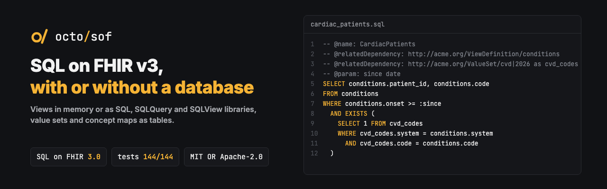

<p align="center"></p>

<p align="center"><b>SQL on FHIR v3 for Rust: run ViewDefinitions in memory or as PostgreSQL and DuckDB SQL, and build SQLQuery jobs with terminology on top.</b></p>

<p align="center">
  <a href="https://github.com/octofhir/sof/actions/workflows/ci.yml"></a>
  <a href="https://crates.io/crates/octofhir-sof"></a>
  <a href="https://docs.rs/octofhir-sof"></a>
  <a href="#license"></a>
</p>

A Rust toolkit for [SQL on FHIR 3.0](https://build.fhir.org/ig/HL7/sql-on-fhir/)
(`hl7.fhir.uv.sql-on-fhir`, the HL7 continuous build of the 3.0.0 ballot):
parse `ViewDefinition` resources and turn FHIR data into flat tables — with no
database required, or by generating SQL — and run the SQL layer 3.0 adds on
top: SQLQuery / SQLView libraries over views, value sets and concept maps.
Views written for 2.0 / 2.1 run unchanged (3.0 kept the view semantics).

**Documentation:** <https://octofhir.github.io/sof>

- **Two interchangeable execution paths**, both passing the full official
  content-test suite (144/144):
  - a **database-free in-memory evaluator** over `serde_json`, and
  - a **PostgreSQL generator** that lowers FHIRPath to SQL over JSONB.
- **Writers**: CSV, NDJSON, JSON, and Parquet (feature-gated), with opt-in
  native temporal types for analytics.
- **Offline lint & validation** of ViewDefinitions (FH01–FH10) with rustc-style
  diagnostics, plus JSON and SARIF output for CI.
- The view model of 3.0: `repeat` and `%rowIndex` on both paths, and the
  structural rules checked before a view runs (SQL names, one iteration
  directive per select, `unionAll` branches with the same columns and types).
- **The SQL layer of 3.0**, host-independent (no database, network or clock;
  a server, a CLI or an embedded engine plugs in where artifacts come from):
  - `library` — SQLQuery / SQLView Libraries: the SQL of a dialect, the
    dependencies, parameter binding, and a builder from annotated SQL
    (`@param`, `@relatedDependency`, ...);
  - `plan` — the dependency graph of a `$sql-run` / `$sql-export` job: one
    resolution per canonical, `context` matching, cycles, CTE order;
  - `relations` and `expansion` — Terminology in SQL: ValueSet and ConceptMap
    dependencies as tables, and a strict ValueSet expander that says what it
    cannot determine instead of leaving it out;
  - `output::RowEncoder` and `ParquetStreamEncoder` — rows streamed to ndjson,
    csv, json or Parquet files without holding the result.
- Every example of the 3.0 guide (views and libraries) is part of the test
  suite.

## Install

```sh
# Prebuilt binary (detects your platform, verifies SHA-256):
curl -fsSL https://raw.githubusercontent.com/octofhir/sof/main/install.sh | sh

# From crates.io:
cargo install octofhir-sof-cli
# Include Parquet output (prebuilt binaries already include it):
cargo install octofhir-sof-cli --features parquet

# …or from a clone of this repo:
cargo install --path crates/octofhir-sof-cli

# …or build and run in place:
cargo build --release
./target/release/octofhir-sof --help
```

Prebuilt binaries for macOS, Linux and Windows are attached to each
[GitHub release](https://github.com/octofhir/sof/releases).

## Usage

```sh
# Run a view over FHIR files, no database — CSV to stdout
octofhir-sof run view.json --input patients.ndjson

# Stream a large NDJSON export with bounded memory (NDJSON in, NDJSON out)
cat export/*.ndjson | octofhir-sof run view.json --input - --output ndjson

# Run every view in a directory in one pass, one output file per view
octofhir-sof run views/ --input data/ --output csv --out out/

# Write real dates/timestamps/times to Parquet (requires the parquet feature)
octofhir-sof run examples/temporal_view.json --input examples/temporal_resources.ndjson \
  --output parquet --parquet-temporal native --out temporal.parquet

# Generate SQL for the view (PostgreSQL JSONB by default, or DuckDB JSON)
octofhir-sof generate view.json
octofhir-sof generate view.json --dialect duckdb

# Generate a CREATE TABLE for the view's columns (ansi | postgres | duckdb)
octofhir-sof generate view.json --ddl --dialect postgres

# Run against PostgreSQL instead of files
octofhir-sof run view.json --db postgres://localhost/fhir --output csv

# Validate a ViewDefinition offline (no FHIR package needed)
octofhir-sof validate view.json
octofhir-sof validate view.json --sarif > results.sarif

# Lint selectors and generated SQL against a FHIR package (any version)
octofhir-sof lint view.json --package hl7.fhir.r4.core
octofhir-sof lint view.json --package hl7.fhir.r5.core --version 5.0.0

# Check a view against the portable ShareableViewDefinition FHIRPath subset
# (offline, no package). --allow-fn exempts a registered custom function.
octofhir-sof lint view.json --shareable

# Run the official content-test format in memory
octofhir-sof test tests/
```

Exit codes: `0` on success, `1` on validation errors, lint errors, test
failures, or I/O errors.

## Library

```rust
use octofhir_sof::{ViewDefinition, execute, SqlGenerator};

let view = ViewDefinition::parse(&json_text)?;

// In-memory:
let result = execute(&view, &resources).await?;

// Or generate SQL:
let sql = SqlGenerator::new().generate(&view)?.sql;
```

For bounded-memory streaming, compile once and run resource-at-a-time:

```rust
use octofhir_sof::CompiledView;

let compiled = CompiledView::compile(&view).await?;
for resource in resources {
    for row in compiled.execute_resource(&resource).await? {
        // row is the column values in column order
    }
}
```

### Parquet temporal encoding

Parquet keeps temporal values as strings by default (`TemporalEncoding::Text`).
With `--parquet-temporal native`, or the library builder below, `date` becomes
Arrow `Date32`, `dateTime`/`instant` become `Timestamp(Microsecond, "UTC")`, and
`time` becomes `Time64(Microsecond)`:

```rust
use octofhir_sof::output::{OutputWriter, ParquetWriter, TemporalEncoding};

let writer = ParquetWriter::new().with_temporal(TemporalEncoding::Native);
writer.write(&result, &mut std::fs::File::create("temporal.parquet")?)?;
```

Build with `--features parquet`. Reduced-precision values are set to the start
of their period (`2026` → January 1, `2026-03` → March 1); date-only timestamps
use midnight UTC. Offsets are normalized to UTC, missing offsets mean UTC,
and finer-than-microsecond precision is truncated. Unparseable or non-string
values become null with a warning that does not log their original contents.
Native encoding loses the original precision and offset; Text preserves them.
No extra precision columns are added. Collection columns remain JSON strings.
The option is accepted but ignored for CSV, JSON and NDJSON.

DuckDB reads the resulting temporal types without casts:

```sh
duckdb -c "DESCRIBE SELECT * FROM read_parquet('temporal.parquet');"
duckdb -c "SELECT birth_date, date_part('year', birth_date) FROM read_parquet('temporal.parquet');"
```

### SQL on FHIR 3.0 jobs

A host resolves a SQLQuery's dependencies with its own lookups and runs the
SQL where it likes; the graph, the relations and the encoding are the
library's:

```rust
use octofhir_sof::library::{SqlLibrary, bind_parameters};
use octofhir_sof::plan::{ContextArtifacts, Resolver, closure};

let query = SqlLibrary::from_json(&library_json, "postgresql")?;
let values = bind_parameters(&query, Some(&parameters_json))?;
let context = ContextArtifacts::from_parameters(&request_json)?;
let mut resolver = Resolver::new(&my_artifact_source, &context, "postgresql");
let edges = resolver.subject(&query).await?;
let job = resolver.finish()?; // views, SQLViews, value set / concept map rows
for (label, artifact) in closure(&job, &edges)? {
    // materialize job.artifacts[artifact] as `label`, then run query.sql
}
```

## SQL dialects

`generate` emits a PostgreSQL JSONB query by default and a DuckDB JSON query
with `--dialect duckdb`; both come from one dialect-parametrized generator and
pass the full content-test suite (DuckDB verified through the `duckdb` CLI). The
in-memory engine (`run --input`, `execute`) needs no database at all.

## FHIR versions

Execution is **version-agnostic**: the engine navigates the resource JSON and is
not coupled to any StructureDefinition, so the same view runs unchanged over R4,
R4B, R5 or R6 resources (the suite includes an R5 `CodeableReference` case). The
schema-driven lint (`lint --package`) accepts any package the canonical manager
can resolve — pass the package name and `--version`, e.g. `hl7.fhir.r4.core`,
`hl7.fhir.r4b.core`, `hl7.fhir.r5.core`, or an R6 build — there is no hard-coded
version.

## Conformance

The official reference tests from
[FHIR/sql-on-fhir.js](https://github.com/FHIR/sql-on-fhir.js) are vendored under
`crates/octofhir-sof/tests/spec/` (refresh with `just update-spec-tests`). Both
execution paths pass the full suite (144/144); the examples of the 3.0 guide
(`tests/fixtures/v3-examples`) read, validate and compile. Run them:

```sh
just conformance                 # in-memory (no database)
just conformance-pg              # against PostgreSQL (needs Docker)
just conformance-duckdb          # against DuckDB (needs the `duckdb` CLI)
just conformance-report          # emit a result file for the sql-on-fhir.org registry
```

See [CONFORMANCE.md](CONFORMANCE.md) for the result-file format and how to submit
our entry to the implementation registry.

## License

Licensed under either of

- Apache License, Version 2.0 ([LICENSE-APACHE](LICENSE-APACHE) or <http://www.apache.org/licenses/LICENSE-2.0>)
- MIT license ([LICENSE-MIT](LICENSE-MIT) or <http://opensource.org/licenses/MIT>)

at your option.

Unless you explicitly state otherwise, any contribution intentionally submitted for inclusion in this project by you, as defined in the Apache-2.0 license, shall be dual licensed as above, without any additional terms or conditions.
